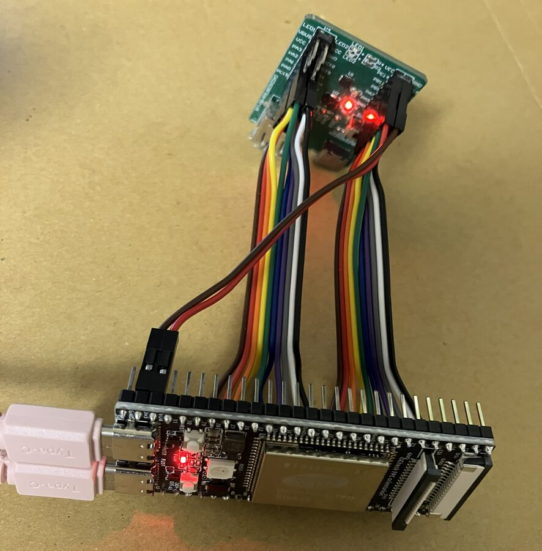

# OpenEmbeddedProbe (an Arduino library for OEP probes)

[日本語](README.ja.md)

## What is OEP?

Open Embedded Probe (OEP) is an open protocol between a **probe** (a small board wired to the chip you develop) and the
**host** software on a PC. One probe serves as a debugger (RVSWD / SWIO for WCH's CH32, SWD for ARM), a console to the
target, and a test fixture (GPIO, UART, SPI / I2C devices, logic capture), and every host (a flash tool, an IDE monitor,
pytest) talks to it the same way.

**The protocol defines the mechanics; the probe's capabilities are open.** OEP defines requests and results, the lock, and
discovery. What a probe can do is open.

- A probe **declares what it can do** (interfaces found by name, with their pins and limits). The host has no table of
  boards and adapts to what the probe has.
- oep-spec defines the standard interfaces (`oep.wire.*`, `oep.target.*`, `oep.fixture.*` and so on). Besides them, **anyone
  can add their own interface**. Under your own reverse-DNS name (`io.github.<you>.<name>`, with a revision you own) it needs
  nobody's permission. A host that does not know it just does not use it. HelloInterface and CustomInterface in
  `examples/02.Interfaces` are examples.
- A **session lock** keeps two programs from driving the probe at the same time.
- It runs over any of **USB vendor bulk, HID, USB CDC, USB-Serial/JTAG and a UART bridge**. A serial port carries the OEP
  frames and the target's console on one line.
- The probe knows only about wires. **What the target is** (flash layout, loaders, how to drive the debug wire) **stays in
  the host**.

## Transports: why OEP runs over several kinds of link

OEP frames are the same on every link; only the wrapping differs (COBS on serial ports, a length on USB bulk and HID). A
probe can carry OEP on any link its chip has (several at once, sharing one session and lock), and the host picks the
fastest one it finds. Each kind exists because some probe needs it.

| Link | What it is good for | probe → host | host → probe | Round trip | Chips in this library |
|---|---|---|---|---|---|
| **USB vendor bulk** (high speed) | Streaming logic and analog capture, writing big flash images. The only link fast enough for a 2-channel 150 Msample/s logic capture (37.5 MB/s) | 33-37 MB/s | 5.5-10 MB/s | 0.37 ms | ESP32-P4 (HS port). RP2040 / RP2350, ESP32-S3 and WCH CH32 at full speed |
| **USB HID** (vendor-defined reports) | No driver on any OS, opens from a browser (WebHID) too. The only class a **software (bit-banged) USB device** can offer: a low-speed device has no bulk endpoints, so a probe built on a chip without a USB peripheral can still be an OEP probe over HID | 0.8-1.1 MB/s (HS). About 8 KB/s for a low-speed device | 1.0 MB/s (HS) | 0.66 ms | ESP32-P4 (HS port), RP2040 / RP2350, ESP32-S3, WCH CH32 (full speed) |
| **USB CDC** (serial port) | Shows up as a COM port: the Arduino IDE's port and serial monitor work as they are, and the target's console shares one wire with OEP | 8.1 MB/s (HS) | 6.7 MB/s (HS) | 0.60 ms | ESP32-P4 (HS port), RP2040 / RP2350, ESP32-S3 (full speed), WCH CH32 (when chosen) |
| **USB-Serial/JTAG** (the ESP32's built-in serial port) | The firmware needs no USB stack. The same port flashes the probe itself (esptool) | about 0.8 MB/s (full speed) | — | — | ESP32-P4 (FS port), ESP32s without USB-OTG (C3, C6, ...) |
| **UART** (through a USB-UART bridge chip: CP2102, CH340 and so on) | Any board with a UART and a bridge chip (most cheap boards) can be a probe. Slow, but enough to flash and debug small targets | about 11 KB/s (115200 baud) | about 11 KB/s | about 5 ms | classic ESP32, ESP32-P4 (GPIO37 / 38), ESP32-S3 (UART0). RP2040 / RP2350 and WCH CH32 when chosen |
| **TCP** (Wi-Fi) | No cable: a probe on the bench network is found by mDNS (`_oep._tcp`), and connections from several hosts share one lock. Trusted networks only (no authentication) | 26-103 KB/s | 23-31 KB/s | about 9 ms (median) | classic ESP32 |

The figures are rough values measured on the test bench (the classic ESP32 at 115200 baud). The low-speed HID figure is the
class's own ceiling (8-byte reports, one per 1 ms), not a measurement.

**Why a probe needs its own USB ID**: the host finds OEP probes without opening USB devices one by one, and treats the same
probe as one device with one serial number (= the probe's `unit_id`) on every link it has (vendor bulk, HID, CDC). Existing
serial ports that cannot be told apart (a USB-UART bridge chip's port, a USB-Serial/JTAG port, a CDC port with another
device's VID:PID) are different. The only way to know whether an OEP probe is behind one is to open the port and try
whether OEP frames come back (negotiate). Opening an arbitrary serial port can disturb what is behind it (a board that resets
on DTR, a modem, another tool's device), so the host cannot try every port automatically, and the user must choose such a
port explicitly. The links above also need USB devices that are not serial ports (vendor bulk for speed, HID for software USB
and browsers). The host automatically identifies an OEP probe only by the project's USB VID:PID `1209:4F45`, and opens a
probe named by its unit_id (the USB serial number) and checks it with describe (oep-spec transports §3 and
docs/usb-identity.md). The firmware's own USB ports (the ESP32-P4's high-speed port, the USB of RP2040 / RP2350 and WCH CH32)
enumerate with `1209:4F45`. A port behind a USB-UART bridge chip and the ESP32-P4's USB-Serial/JTAG port keep their fixed IDs,
and the user chooses them.

A UART's 115200 baud is a speed every board and bridge chip passes. A probe cannot assume anything faster (some bridge chips
and boards do not pass 921600 reliably). The host stays at 115200 unless the probe and the host agree. The classic ESP32
firmware has the optional `port_speed` (in `oep.probe.link`, oep-if-link §3): a host that asks tries a speed, checks it with
a larger transfer in both directions, and then fixes that speed for its session. The probe goes back to 115200 by itself when
the check does not come, frames break, the wire goes quiet, or the session ends (`begin<oep::kDefaults & ~oep::kPortSpeed>()`
leaves it out; [firmware features](docs/guide/firmware-features.md)).

This library turns an ESP32-P4, a classic ESP32, an ESP32-S3, an RP2350, an RP2040 or a WCH CH32 into such a probe.

- Usage: [What OEP does for you](docs/guide/use-cases.md) (per thing you want to do: what to prepare, wiring, settings),
  [Debug targets](docs/guide/debug-targets.md), [Capture: which way](docs/guide/capture.md), [Settings](docs/guide/settings.md).
- Guides: [Getting started](docs/guide/getting-started.md) (flash, find, use from Python),
  [Adding your own commands](docs/guide/simple-interface.md) (just register functions), [Your first interface](docs/guide/your-first-interface.md), [Firmware features](docs/guide/firmware-features.md) (leave out, add your own),
  [Writing a probe](docs/guide/writing-a-probe.md) (the detailed guide), [Boards](docs/guide/boards.md) (what each chip does, building for other boards).
- Specification: [oep-spec](https://github.com/Open-Embedded-Probe/oep-spec) (until the freeze the Japanese text is
  authoritative). Start with the [README](https://github.com/Open-Embedded-Probe/oep-spec/blob/main/README.md) and [the review guide](https://github.com/Open-Embedded-Probe/oep-spec/blob/main/docs/review-guide.md).
  [Getting started](https://github.com/Open-Embedded-Probe/oep-spec/blob/main/docs/getting-started.md) builds the smallest probe and host, the protocol core is
  [docs/oep-core.md](https://github.com/Open-Embedded-Probe/oep-spec/blob/main/docs/oep-core.md), what conformance needs is
  [docs/conformance.md](https://github.com/Open-Embedded-Probe/oep-spec/blob/main/docs/conformance.md), and the number table is [registry/oep-v1.toml](https://github.com/Open-Embedded-Probe/oep-spec/blob/main/registry/oep-v1.toml).
- Host library: [oep-client-python](https://github.com/Open-Embedded-Probe/oep-client-python) (`pip install oep-client-python`,
  the `oep` command, a virtual bench for tests).
- USB VID:PID: the project's own `1209:4F45` (pid.codes). Who may use it: [PID-USE.md](PID-USE.md). On Linux, opening the
  vendor bulk / DFU interfaces (libusb) and HID (hidraw) as an ordinary user needs the udev rule shipped by oep-client-python,
  [`udev/70-oep-probe.rules`](https://github.com/Open-Embedded-Probe/oep-client-python/blob/main/udev/70-oep-probe.rules), installed once with administrator rights
  (`sudo install -m 0644 70-oep-probe.rules /etc/udev/rules.d/`, then `sudo udevadm control --reload-rules && sudo udevadm trigger`).

## Wiring: no schematic, no fixed pin map

OpenEmbeddedProbe is firmware only. There is no board or circuit of its own. A probe is a stock development board of a
supported microcontroller (ESP32-P4, classic ESP32, ESP32-S3, RP2040 / RP2350, WCH CH32) with this firmware written to it, so there is
no schematic to follow. There is no fixed pin map either.

- **Debug wires and GPIO wires may go to any free GPIO.** Every debug wire (RVSWD, SWIO, SWD) is bit-banged, and the host
  chooses the GPIO fixture's pins per request. On an ESP32 the UART, SPI and I2C fixtures also go through the GPIO matrix, so
  they too take any pin.
- **Pins are fixed only where a hardware peripheral is used.** The UART fixtures of an RP2040 / RP2350 are the chip's UARTs.
  On an RP2040, instance 0 (UART0) takes RX on one of GP1, 13, 17, 29 and TX on one of GP0, 12, 16, 28, and instance 1 (UART1)
  RX on one of GP5, 9, 21, 25 and TX on one of GP4, 8, 20, 24. An RP2350 offers its own candidates. Analog capture uses the
  ADC pins on every chip (RP2 GP26-28, ESP32-P4 GPIO16-23, classic ESP32 GPIO32-36 / 39, ESP32-S3 GPIO1-10), and the classic ESP32's SWIO needs
  an output below GPIO32. Wire these lines to such a pin. The list per chip is in [Boards](docs/guide/boards.md#pins-of-the-released-firmware).
- **The host finds where the target is connected.** oep-client-python's `oep pins` reads every pin the probe offers under
  the probe's pulls, scans the debug wire over the candidates, identifies the target by its ID, and finds the reset line. At
  the end it shows the port labels to save (`S.swdio`, `S.swclk`, `S.nrst`; oep-spec host developer guide §5.3).
- **The rest of the wires can be found through the target.** Once the debug wire works, the host drives the target's own
  GPIOs through it and sees which probe pin follows. So the target's other wires (UART, power switch, application pins) are
  found the same way, without a wiring table.

So connect GND, the target's debug pins and any other lines you want to free GPIOs of the probe board, in any order. What to
avoid is the probe board's own pins. The firmware does not offer the flash / PSRAM pins, the USB pins, the boot-mode strap
pins, or the pins of the probe's own transport. The list per chip is in [Boards](docs/guide/boards.md#pins-of-the-released-firmware).
Mind the signal voltages too ([Electrical notes](#electrical-notes)).

## An example: testing a CH32L103 with an ESP32-P4



One ESP32-P4 board, with every pin you want to watch wired to a CH32L103, is a test bench by itself.

- **Flash and debug the target**: flash over RVSWD, halt / run / step one instruction, read and write memory
  (`oep.wire.rvswd`, `oep.target.riscv-dm`). With [ArduinoCore-CH32RV](https://github.com/ch32-riscv-ug/ArduinoCore-CH32RV) you
  can upload from the Arduino IDE through the probe (an `oep://...` port).
- **Read the console**: through the debug module (`oep.target.console`, no UART needed) or a UART (`oep.fixture.uart`).
- **Check what the target's code does with its pins**: the P4 receives as the device on the other side (an SPI device, an
  I2C device), so a test sees the bytes the target's driver really sent. It can also answer the target over GPIO or UART
  (`oep.fixture.gpio` / `uart`, `oep.fixture.spi-target` / `i2c-target`).
- **Capture up to 16 pins at once**: even while acting as the SPI device (`oep.fixture.logic`, the P4's PARLIO).

  The top rate depends on the mode and the line count (streaming: 160 Msps at 2 ch, 40 Msps at 8 ch and so on; one-shot
  without a trigger: 160 Msps). The table is in [the capture guide](docs/guide/capture.md#esp32-p4--p4x-speeds-and-lines).

  Which pins to capture is chosen per request (the plan). Each test item captures only the pins it needs, and neither the
  wiring nor the firmware changes between tests. The samples go to a sigrok session file (`LogicCapture.to_sr`, opens in
  PulseView) or to a run recorder such as [WireSkein](https://github.com/Open-Embedded-Probe/wireskein), so tests can check at
  the signal level, not only results.

The host chooses all of the above at run time. The same firmware serves every test.

## Electrical notes

This library does not deal with signal levels. The probe's pins are the MCU's own pins.

- The ESP32-P4 is a 3.3 V part. To connect a 5 V target, put something like a **bidirectional, fast level converter** in
  between.
- Lines that are only received (capture and so on) can meet a 5 V part through a **fast buffer** in between.
- A **fast comparator** in front of an input makes the logic threshold adjustable. The ESP32-P4 has an adjustable LDO, so the
  threshold voltage needs no external parts.

## This library

A library for writing Open Embedded Probe (OEP) probes with Arduino, and the firmware of each probe (`examples/`). It speaks
v1 (oep-spec's `docs/oep-core.md`, `docs/oep-transports.md` and the interfaces `interfaces/oep-if-*.md`). This is v1 before
the freeze; until the freeze the specification may break. It is an experimental stage that assumes breaking changes, and no
compatibility is promised.

**The specification it implements: the oep-spec commit in `tests/vectors/SPEC_COMMIT`** (an implementation before the freeze
names the commit of the specification it implements; versioning §6). It is copied with `tools/sync_registry.sh`, and what
changed with each one is in [CHANGELOG.md](CHANGELOG.md). Until the freeze the Japanese text (`*.ja.md`) is the working text.

The numbers on the wire are defined only in oep-spec's `registry/oep-v1.toml`, and its generated output is copied to
`src/OepRegistry.h`. The specification's shared byte vectors are copied to `tests/vectors/`, and `tests/host/test_vectors.cpp`
runs all of them against this endpoint.

## Layout

| PATH | Contents |
|---|---|
| `src/Oep.h`, `src/OepEndpoint.*`, `src/OepRegistry.h` | the v1 core (oep-core, oep-transports): frames, interfaces found by name and their ops, the lock, several transports (describe's transport), sharing serial ports (transports §4), notifications (subscribe on the emitting fn), fn 0's clock. `oep::ProbePlan` / `oep::ProbeRestart` are `oep.probe.plan` / `oep.probe.restart`, which the endpoint offers itself after the sketch's interfaces. `oep::Link` is `oep.probe.link` (the wire test, port_speed) |
| `src/OepMemo.*`, `src/OepFlashFs.*` | `oep.probe.memo` (oep-if-memo): the host's named objects as files on the probe's LittleFS. Written to a temporary file and renamed into place at the last write. The LittleFS mount the memo area and the settings share (ESP32: the data partition `spiffs`; RP2040 / RP2350: the FS area of the board's flash selection) |
| `src/OepTcp.h`, `src/OepWifi.h` | TCP (a listener whose accepted connections each become a transport; lwIP sockets) and Wi-Fi on an ESP32 (tries the settings' networks in order, mDNS `_oep._tcp`). Header only, so only a sketch that includes them has the network |
| `src/OepBind.*` | what flows on a serial port (bind: one stream per port, stopped during a session and resumed from where it stopped) |
| `src/OepStream.h`, `src/OepDebug.h` | parts the standard interfaces share (position streams, wire and target status and pin pairs) |
| `src/OepTarget.*`, `src/OepSwd.*`, `src/OepConsole.*`, `src/OepFixture.*`, `src/OepCapture.*`, `src/OepSampler.*`, `src/OepSettings.*` | standard interfaces: wires and targets (`oep.wire.rvswd` / `swio` / `swd`, `oep.target.riscv-dm` / `arm-adi`), the console, fixtures (gpio / uart / capture). The core's settings (core §13: declaring items, initial values, labels unique without regard to case, saving by name; a LittleFS file on ESP32 and RP2040 / RP2350). Each file starts with the specification sections it follows |
| `src/OepP4I2cTarget.*`, `src/OepP4SpiTarget.*`, `src/OepRp2SpiTarget.*`, `src/OepCh32SpiTarget.*` | the standard interfaces `oep.fixture.i2c-target` / `spi-target` (revision 1; implemented on the ESP-IDF I2C / SPI slaves, the RP2's PIO, the CH32 core's SPI slave) |
| `src/OepI2cController.*`, `src/OepSpiController.*`, `src/OepPwm.*`, `src/OepCounter.*`, `src/OepDac.*` | fixtures that drive the target: `oep.fixture.i2c-controller` / `spi-controller` (bit-banged on any GPIO), `pwm`, `counter`, `dac` |
| `src/OepAnalog.*`, `src/OepRp2Logic.*`, `src/OepCh32Logic.*`, `src/OepH41xLogic.*`, `src/OepCaptureGroup.*` | captures per chip: `oep.fixture.analog`, the RP2's PIO and the CH32's `oep.fixture.logic` (on CH32H41x also UHSIF), `oep.fixture.capture-group` |
| `src/OepFirmware.h`, `src/OepFirmwareParts.h`, `src/firmware/` | the released firmware as parts (`oep::firmware`). The contents per chip are the headers in `src/firmware/` (`Rp2.h`, `Esp32P4.h`, `Esp32.h`, `EspSoc.h`, `Ch32.h`) |
| `src/OepChoice.h` | how each firmware part becomes a choice that links nothing when left out (`begin<F>()` calls `oepAddX()` for each feature in F; `Slot`, `HeapSlot`, `Hooks`; [firmware features](docs/guide/firmware-features.md)) |
| `src/OepSimpleInterface.*`, `src/OepWorker.*`, `src/OepProbeLog.h` | an interface made by just registering functions (`oep::SimpleInterface`), a worker that runs long jobs, a log stamped with the probe's clock ([adding your own commands](docs/guide/simple-interface.md)) |
| `src/OepCh32Dm.*`, `src/OepRvswdPhy.*`, `src/OepSwioPhy.*`, `src/OepDmConsole.*`, `src/OepPinTable.h`, `src/OepPlatform.h`, `src/OepFrame.*` and others | parts (the CH32 debug module, wire physical layers, console framings, the pin table with its owners (`oep::owners`) and idle states, Arduino core differences, frames) |
| `examples/` | the board firmware and examples to learn from: see [Examples](#examples) |
| `tests/host/` | host tests of the portable parts (reading serial ports, the endpoint's sharing rules, binds): `tests/host/run.sh` (g++) |
| `tests/compile/`, `.github/workflows/tests.yml` | regression tests of the P4 / P4X profiles and the Release models; builds every P4 example with both profiles. `python3 tests/compile/test_profiles.py`; the firmware identity is checked with `tools/check_p4_firmware.py` |
| `tools/sync_registry.sh` | copies oep-spec's `generated/oep-v1/oep_v1_registry.h` to `src/OepRegistry.h` and `tests/vectors/*.json` to `tests/vectors/` (`OEP_SPEC_REF` picks the commit) |
| `tools/bump_version.py`, `tools/sync_release_assets.py`, `.github/workflows/release.yml` | releases (arduino-library-release-toolkit's, used as is; not edited) |
| `docs/guide/` | the guides (English and Japanese), by reader: [what OEP does for you](docs/guide/use-cases.md), [debug targets](docs/guide/debug-targets.md), [capture: which way](docs/guide/capture.md), [settings](docs/guide/settings.md) (users), [getting started](docs/guide/getting-started.md) (using a probe), [adding your own commands](docs/guide/simple-interface.md) (just register functions), [your first interface](docs/guide/your-first-interface.md) (beginners), [firmware features](docs/guide/firmware-features.md) (choose what the firmware has, add your own), [writing a probe](docs/guide/writing-a-probe.md) (the detailed guide), [adding a standard interface](docs/guide/adding-a-standard-interface.md) (contributors to the library), [boards](docs/guide/boards.md) |
| `docs/` | this implementation's values and limits (implementation limits), the verification and transfer procedures |

A sketch includes the same parts as the headers the released firmware (`examples/Firmware/OepProbe`) uses: the core
(`OepEndpoint.h`, `OepPlatform.h`, `OepPinTable.h`, `OepSettings.h`, `OepChoice.h`, `OepBind.h`, `OepBootGuard.h`,
`OepLog.h`, `OepProbeLog.h`), the transports (`OepWifi.h`, `OepTcp.h`, `OepDirectBulkStream.h`, `OepRp2Usb.h`), and the
standard interfaces and wire physical layers (each row of the table above). The following headers are parts used inside
those, not included directly from a sketch: `OepFrame.h`, `OepRvswdFrame.h`, `OepDmiPhy.h`, `OepWireGate.h`,
`OepWireLoss.h`, `OepLimits.h`, `OepLogicBlocks.h`, `OepAnalogBlocks.h`, `OepSamplerRun.h`, `OepUartRx.h`,
`OepEspBitBang.h`, `OepCh32BitBang.h`, `OepDebug.h`, `OepStream.h`, `OepResult.h`, `OepRegistry.h`. The types they define
(`oep::Result`, `oep::PositionStream` and so on) are used through the parts above. No part promises compatibility across
versions.

## Examples

Open one from `File > Examples > OpenEmbeddedProbe` in the Arduino IDE, or build it with its `sketch.yaml` profile
(`arduino-cli compile --profile <profile> <dir>`). Every sketch has an explanation and the host-side usage in its opening
comment.

| Example | Boards (profile) | What it shows |
|---|---|---|
| `Firmware/OepProbe` | Pico / Pico 2 and other RP2040 / RP2350 boards (rp2040, rp2350), ESP32-P4 (esp32p4) / P4X (esp32p4x), classic ESP32 (esp32), ESP32-S3 (esp32s3), WCH CH32 (ch32x035, ch32v307, ch32h417) | **The firmware to flash** (also on the Releases): everything the chip can do, every pin chosen by the host. A jig = its settings |
| `01.Basics/MinimalProbe` | RP2040 (rp2040), RP2350 (rp2350), classic ESP32 (esp32) | the smallest probe: fn 0 (the core) only, no interface. Endpoint, transport, describe |
| `01.Basics/FixtureProbe` | RP2040 (rp2040), RP2350 (rp2350), classic ESP32 (esp32) | a test fixture: GPIO and UART on pins the host decides with the plan (pin table, owners, plan) |
| `02.Interfaces/HelloInterface` | RP2040 (rp2040), RP2350 (rp2350), classic ESP32 (esp32) | **your first interface**: a name, two ops, the lock. No pins |
| `02.Interfaces/CustomInterface` | RP2040 (rp2040), RP2350 (rp2350), classic ESP32 (esp32) | **extending OEP**: your own interface under your own name. describe, plan, ops, TLV tails |
| `03.Transports/MultipleTransports` | ESP32-P4 (esp32p4) / P4X (esp32p4x) | one endpoint on four USB transports at once (HS vendor bulk, HID, CDC, USB-Serial/JTAG), USB identity |
| `03.Transports/WifiTcp` | classic ESP32 (esp32) | OEP over TCP on Wi-Fi: the serial port and a TCP listener (3 connections), networks from the settings' wifi item, mDNS |
| `04.Debug/RvswdDebugProbe` | RP2040 (rp2040), ESP32-P4 (esp32p4) / P4X (esp32p4x), ESP32-S3 (esp32s3) | a CH32 debugger on RVSWD: wire, riscv-dm, console |
| `04.Debug/SwioDebugProbe` | classic ESP32 (esp32) | a CH32V00x debugger on the one-wire SWIO |
| `04.Debug/SwdDebugProbe` | RP2040 (rp2040) / RP2350 (rp2350) | an ARM debugger on SWD: wire, arm-adi |
| `05.Capture/LogicCapture` | ESP32-P4 (esp32p4) / P4X (esp32p4x) | a full-speed logic analyzer (up to 16 ch, 160 Msps at 2 ch when streaming), streaming over HS. Comes with `host/stream_test.py` |
| `06.Settings/Settings` | RP2040 (rp2040) / RP2350 (rp2350) | a jig with settings: pin labels, idle states, unused pins, pass-through (the target's console on the probe's port). Saved by name in flash |
| `Tools/SwdPinSurvey` | RP2040-Zero (rp2040zero), RP2350 (rp2350) | a bring-up tool (text on Serial, not OEP): which pins are a debug port |

## Getting started

The short version. [The guide](docs/guide/getting-started.md) continues (GPIO / UART, debugging, capture, settings).

1. **Firmware**: use a built one from the [Releases](https://github.com/Open-Embedded-Probe/oep-probe-arduino/releases)
   (for any RP2040 / RP2350 board, copy `OepProbe-rp2040-<version>.uf2` / `OepProbe-rp2350-<version>.uf2` to the board in
   BOOTSEL mode. For an ESP32-P4 / classic ESP32, `esptool.py write_flash 0x0 <file>` with
   `OepProbe-esp32p4-<version>.merged.bin` / `OepProbe-esp32-<version>.merged.bin`. For a WCH CH32,
   `OepProbe-ch32x035-<version>.bin` and so on from the start of the code flash. The host chooses the pins. The sha256 is in
   `firmware-<version>.json`). To build it yourself, install **OpenEmbeddedProbe** with the Arduino Library Manager, open
   `File > Examples > OpenEmbeddedProbe`, and build with its `sketch.yaml` profile (the core version and the libraries are
   pinned there):

   ```sh
   arduino-cli compile --clean --profile esp32p4 examples/Firmware/OepProbe
   arduino-cli upload -p <port> --profile esp32p4 examples/Firmware/OepProbe
   ```

   For ESP32-P4X use profile `esp32p4x` and `OepProbe-esp32p4x-<version>.merged.bin`. For telling the P4 and P4X apart and
   the revision check on a DFU update, see [the guide](docs/guide/getting-started.md#1-flash-the-firmware).

   **Transfer the firmware before use** (you cannot tell what is on a board).
2. **Host**: after `pip install oep-client-python`, see what the probe has:

   ```sh
   oep dump --port <port>
   ```

   From Python, `oep_client.link.open_host(<port>)` gives a session. A serial port (USB-Serial/JTAG, USB CDC, a UART bridge)
   carries OEP frames (`0x00 <COBS> 0x00`) and the bind's raw bytes on one line. The host opens it exclusively (TIOCEXCL)
   and drops what is outside frames as noise (oep-spec host developer guide §1, §2).
3. **Settings**: to carry the target's console on a serial port while there is no session, set the console's pass-through
   (the core's settings, oep-spec core §13; on ESP32 and RP2040 / RP2350 saved by name in a file on the probe's LittleFS).
   Pins are named as in the datasheet (`GPIO2`), ports by the transport's name (`cdc0`). Name the port with the `S.N`
   labels (the host names it `oep://<probe>/<port>`):

   ```sh
   oep settings set <probe> core channel.GPIO2.label=l103.swdio channel.PB6.label=l103.swclk
   oep settings set <probe> oep.target.console/0 passthrough.cdc0.wire=oep.wire.rvswd/0 passthrough.cdc0.swdio=GPIO2 \
       passthrough.cdc0.swclk=PB6 passthrough.cdc0.max-speed=1000000 passthrough.cdc0.mechanism=dmseq --save
   oep settings show <probe>
   oep settings export <probe> jig.oep-settings.json   # before updating the firmware; import puts it back later
   ```

## Known traps

- Arduino.h makes `word(...)` a macro for `makeWord(...)`. A lambda or function named `word` returns its argument as is.
- On the ESP32-P4, using `pinMode` / `digitalWrite` on the same pins after `RvswdPhy::begin` takes them out of the dedicated
  GPIO bundle for good (a chip reset is needed).
- Vendor bulk OUT is received per packet (EspUsbDevice's callback receive). Receiving by waiting for the end of the transfer
  (a ZLP) delays the completion of a request that ends exactly on a multiple of 512 bytes (such as a 1024-byte write_block)
  until the next OUT.

## Release assets

A GitHub Release carries the firmware of each profile of `examples/Firmware/`: `<Example>-<profile>-<version>.merged.bin` (ESP32,
written at 0x0) / `.bin` (ESP32, the app image for updates; the P4's DFU) / `.uf2` (RP2040 / RP2350) / `.bin` (CH32, the whole code
flash), and `firmware-<version>.json` (sha256). The probe reports the same version in describe's firmware string. How releases are
made is in [Contributing](CONTRIBUTING.md).

`firmware-<version>.json` is this repository's rule (not an OEP norm):

```json
{"schema": 1, "library": "OpenEmbeddedProbe", "version": "<version>", "firmware": [
  {"example": "Firmware/OepProbe", "profile": "esp32p4", "file": "OepProbe-esp32p4-<version>.bin", "kind": "app",
   "model": "esp32p4", "fqbn": "esp32:esp32:esp32p4:...", "flash_offset": null, "sha256": "..."}]}
```

| Field | Meaning |
|---|---|
| `schema` | 1. A reader refuses another number. Fields are only added |
| `kind` | `merged` (ESP32, the whole image written from `flash_offset` 0), `app` (ESP32, the app image: an update into the other app partition, the P4's DFU), `uf2` (RP2040 / RP2350), `flash` (CH32, from the start of the code flash, 0x08000000; `flash_offset` 0) |
| `model` | the value this image reports as describe's model (`esp32p4`, `esp32p4x`, `esp32`, `esp32s3`, `rp2040`, `rp2350`, `ch32x035`, `ch32v307`, `ch32h417`): the chip it was built for. describe's chip TLV is `<part> v<rev>` of the running part (for example `esp32p4 v3.2` even on a P4X) |
| `fqbn`, `flash_offset` | what it was built with; `flash_offset` is where the image is written: 0 for `merged` and `flash`, `null` for the others |
| `sha256` | the file's sha256 |

The describe firmware string of a sketch built with this library is the library's release version
(`OPENEMBEDDEDPROBE_VERSION_STR`), the same as the Release and `version` above. A build from a work tree reports the version
in `library.properties`. OEP does not define the string (core §7.5); this is this repository's rule.

## License

MIT ([LICENSE](LICENSE)). Every source file says so too (`SPDX-License-Identifier: MIT`). The USB VID:PID is not covered by
it: [PID-USE.md](PID-USE.md).

For building, transferring and checking on hardware, see [the uv / pytest entry point](docs/firmware-transfer.md). The
settings template is `tests/.env.example`.
